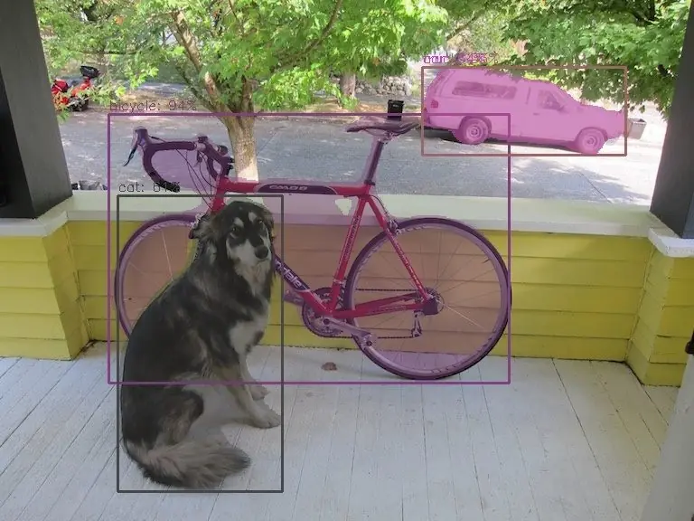

<!-- Generated by DX AI Studio (python -m dx_modelzoo.tools.export_dx_app_cards). Do not edit by hand. -->

# Ultralytics YOLO26-n-seg

Instance Segmentation · `yolo26-n-seg_640x640` · DX-APP C++ example

Ultralytics YOLO26-n-seg — instance segmentation model, trained on COCO.

**Input** 640 × 640 × 3 · **Dataset** COCO · **License** AGPL-3.0 · **Quantization** Q-Lite, Q-Pro, Q-Master



Full card with copy buttons and dark/light theme: [model.html](../../../../python_example/instance_segmentation/yolo26_seg/yolo26-n-seg_640x640/model.html)

## Quick start

Run from the dx_app root after `./install.sh` and `./build.sh`.

```bash
# from the dx_app root
./setup_sample_models.sh --models yolo26n-seg
```

**C++**

```bash
./build.sh --target yolo26-n-seg_640x640_sync   # once
./bin/yolo26-n-seg_640x640_sync \
  -m assets/models/yolo26-n-seg_640x640.dxnn \
  -i sample/img/sample_street.jpg
```

**Python**

```bash
python src/python_example/instance_segmentation/yolo26_seg/yolo26-n-seg_640x640/yolo26-n-seg_640x640_sync.py \
  --model assets/models/yolo26-n-seg_640x640.dxnn \
  --image sample/img/sample_street.jpg
```

## Performance

**240 FPS** and **259.5 FPS/W** on DX-M1, DX Model Zoo reference measurement.

### Accuracy

| Quantization | mAP |
|---|---:|
| Raw · ONNX | 30.92 |
| Q-Lite | 30.51 (−0.41) |
| Q-Pro | 30.59 (−0.33) |
| Q-Master | 30.64 (−0.28) |

COCO · difference vs Raw in brackets.

### Measured on host boards

| Board | Throughput FPS | Single-stream FPS | Latency ms |
|---|---:|---:|---:|
| DX-H1 Quattro · BIOSTAR | 592.9 | 54.9 | 18.2 |
| DX-M1 · AIPlayer N97 | 180.4 | 27.3 | 36.6 |
| DX-M1 · Orange Pi 5+ | 191.3 | 22.7 | 44.0 |
| DX-M1 · ROCK 5B+ | 166.6 | 32.8 | 30.5 |
| DX-M1 · Raspberry Pi 5 | 95.7 | 28.2 | 35.5 |
| DX-M1M · Raspberry Pi 5 | 95.7 | 26.4 | 37.8 |

DX AI Studio Benchmark, July 2026, DX-RT without ORT. Throughput: 5 in-flight buffers. Single-stream: 1.

## Model

| | |
|---|---|
| Task | Instance Segmentation |
| Dataset | COCO |
| Metric | mAP |
| Input | 640 × 640 × 3 |
| Parameters | 2.77 M |
| Operations | 5.68 GOPs |
| Family | yolo26_seg |

## Downloads

| Artifact | Compiler | Files |
|---|---|---|
| ONNX | — | [ONNX](https://sdk.deepx.ai/modelzoo/onnx/yolo26-n-seg_640x640.onnx) |
| Q-Lite | DX-COM 2.5.0 | [DXNN](https://sdk.deepx.ai/modelzoo/q-lite-dxnn/2_5_0/yolo26-n-seg_640x640.dxnn) · [JSON](https://sdk.deepx.ai/modelzoo/q-lite-json/2_5_0/yolo26-n-seg_640x640.json) |
| Q-Pro | DX-COM 2.4.0 | [DXNN](https://sdk.deepx.ai/modelzoo/q-pro-dxnn/2_4_0/yolo26-n-seg_640x640.dxnn) |
| Q-Master | DX-COM 2.4.0 | [DXNN](https://sdk.deepx.ai/modelzoo/q-master-dxnn/2_4_0/yolo26-n-seg_640x640.dxnn) · [JSON](https://sdk.deepx.ai/modelzoo/q-master-json/2_4_0/yolo26-n-seg_640x640.json) |

## Files in this example

| File | What it is |
|---|---|
| `yolo26-n-seg_640x640_sync.cpp` | C++ · one image, video or camera |
| `yolo26-n-seg_640x640_async.cpp` | C++ · pipelined, higher throughput |
| `config.json` | Thresholds, input size, default sample |
| `factory/` | Pre-, post-processor and visualizer |

[Python version of this example](../../../../python_example/instance_segmentation/yolo26_seg/yolo26-n-seg_640x640/)

## Source & License

[ultralytics/ultralytics](https://github.com/ultralytics/ultralytics) — AGPL-3.0 (GNU Affero General Public License v3.0 — https://www.gnu.org/licenses/agpl-3.0.html) · © Ultralytics. Check the upstream license before commercial use.

Compile it yourself: DX-COM in dx-compiler, or DX AI Studio → Compiler.

---

<sub>Generated from the DX Model Zoo publish table (as of 2026-10-13). Board measurements: DX AI Studio Benchmark, July 2026. Open this model in DX AI Studio → Model Zoo for live inference and the model graph.</sub>
