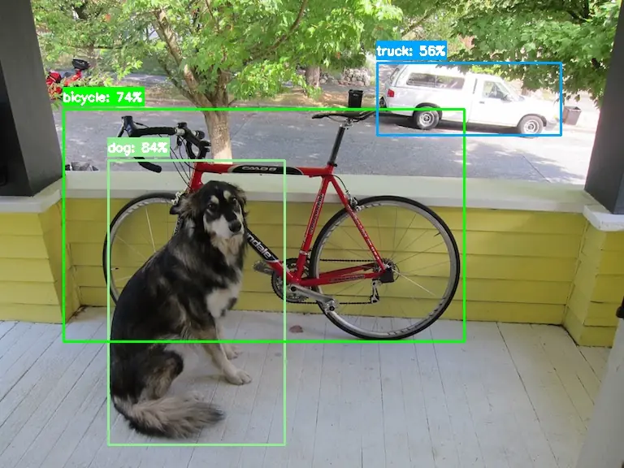

<!-- Generated by DX AI Studio (python -m dx_modelzoo.tools.export_dx_app_cards). Do not edit by hand. -->

# YOLOXN-1

Object Detection · `yolox-n_416x416` · DX-APP C++ example

Object Detection model.


> Not published in DX Model Zoo.



Full card with copy buttons and dark/light theme (open it in a browser; GitHub shows its source): [model.html](../../../../python_example/object_detection/yolox/yolox-n_416x416/model.html)

## Quick start

Run from the dx_app root after `./install.sh` and `./build.sh`.

```bash
# from the dx_app root
./setup_sample_models.sh --models yolox-n_416x416
```

**C++**

```bash
./build.sh --target yolox-n_416x416_sync   # once
./bin/yolox-n_416x416_sync \
  -m assets/models/yolox-n_416x416.dxnn \
  -i sample/img/sample_street.jpg
```

**Python**

```bash
python src/python_example/object_detection/yolox/yolox-n_416x416/yolox-n_416x416_sync.py \
  --model assets/models/yolox-n_416x416.dxnn \
  --image sample/img/sample_street.jpg
```

## Accuracy

Numbers from the DX AI Studio catalog; this model is not in the DX Model Zoo publish table.

No accuracy published.

## Model

| | |
|---|---|
| Task | Object Detection |
| Metric | Accuracy |
| Family | yolox |

## Downloads

| Artifact | Compiler | Files |
|---|---|---|
| DXNN (dx_app manifest) | DX-COM 2.5.0 | [DXNN](https://sdk.deepx.ai/modelzoo/q-master-dxnn/2_5_0/yolox-n_416x416.dxnn) |

## Files in this example

| File | What it is |
|---|---|
| `yolox-n_416x416_sync.cpp` | C++ · one image, video or camera |
| `yolox-n_416x416_async.cpp` | C++ · pipelined, higher throughput |
| `config.json` | Thresholds, input size, default sample |
| `factory/` | Pre-, post-processor and visualizer |

[Python version of this example](../../../../python_example/object_detection/yolox/yolox-n_416x416/)

## Source & License

—. Check the upstream license before commercial use.

Compile it yourself: DX-COM in dx-compiler, or DX AI Studio → Compiler.

---

<sub>Generated by DX AI Studio from the dx_app registry and the DX AI Studio catalog. Open this model in DX AI Studio → Model Zoo for live inference and the model graph.</sub>
