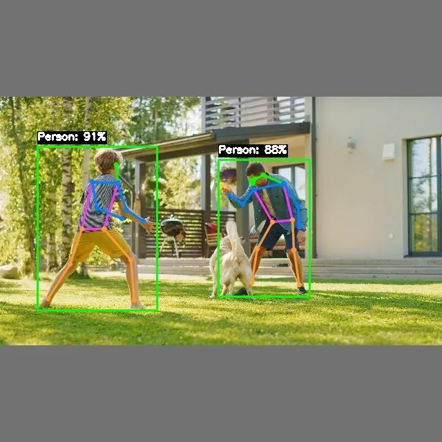

<!-- Generated by DX AI Studio (python -m dx_modelzoo.tools.export_dx_app_cards). Do not edit by hand. -->

# YOLOV5Pose_PPU

Pose Estimation · `YOLOV5Pose_PPU` · DX-APP C++ example

Pose Estimation model, evaluated on COCO.

**Input** 640 × 640 × 3 · **Dataset** COCO · **License** GPL-3.0

> Not published in DX Model Zoo.



Full card with copy buttons and dark/light theme (open it in a browser; GitHub shows its source): [model.html](../../../../python_example/pose_estimation/yolov5_pose/YOLOV5Pose_PPU/model.html)

## Quick start

Run from the dx_app root after `./install.sh` and `./build.sh`.

```bash
# from the dx_app root
./setup_sample_models.sh --models YOLOV5Pose_PPU
```

**C++**

```bash
./build.sh --target YOLOV5Pose_PPU_sync   # once
./bin/YOLOV5Pose_PPU_sync \
  -m assets/models/YOLOV5Pose_PPU.dxnn \
  -i sample/img/sample_street.jpg
```

**Python**

```bash
python src/python_example/pose_estimation/yolov5_pose/YOLOV5Pose_PPU/YOLOV5Pose_PPU_sync.py \
  --model assets/models/YOLOV5Pose_PPU.dxnn \
  --image sample/img/sample_street.jpg
```

## Performance

Numbers from the DX AI Studio catalog; this model is not in the DX Model Zoo publish table.

Throughput for this model is not published yet. Measure it on your board:

```bash
python src/python_example/pose_estimation/yolov5_pose/YOLOV5Pose_PPU/YOLOV5Pose_PPU_sync.py \
  --model assets/models/YOLOV5Pose_PPU.dxnn \
  --image sample/img/sample_street.jpg \
  --loop 100 --no-display
```

### Accuracy

| Quantization | mAP |
|---|---:|
| Raw · ONNX | 57.50 |

## Model

| | |
|---|---|
| Task | Pose Estimation |
| Dataset | COCO |
| Metric | mAP |
| Input | 640 × 640 × 3 |
| Parameters | 7.06 M |
| Operations | 10.20 GOPs |
| Family | yolov5_pose |

## Downloads

| Artifact | Compiler | Files |
|---|---|---|
| DXNN (dx_app manifest) | DX-COM 2.4.0 | [DXNN](https://sdk.deepx.ai/modelzoo/dxnn/2_4_0/YOLOV5Pose_PPU.dxnn) |

## Files in this example

| File | What it is |
|---|---|
| `YOLOV5Pose_PPU_sync.cpp` | C++ · one image, video or camera |
| `YOLOV5Pose_PPU_async.cpp` | C++ · pipelined, higher throughput |
| `config.json` | Thresholds, input size, default sample |
| `factory/` | Pre-, post-processor and visualizer |

[Python version of this example](../../../../python_example/pose_estimation/yolov5_pose/YOLOV5Pose_PPU/)

## Source & License

[TexasInstruments/edgeai-yolov5](https://github.com/TexasInstruments/edgeai-yolov5) — GPL-3.0 (GNU General Public License v3.0 — https://www.gnu.org/licenses/gpl-3.0.html) · © TexasInstruments. Check the upstream license before commercial use.

Compile it yourself: DX-COM in dx-compiler, or DX AI Studio → Compiler.

---

<sub>Generated by DX AI Studio from the dx_app registry and the DX AI Studio catalog. Open this model in DX AI Studio → Model Zoo for live inference and the model graph.</sub>
