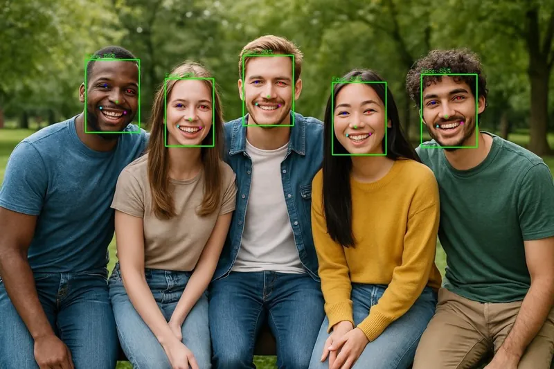

<!-- Generated by DX AI Studio (python -m dx_modelzoo.tools.export_dx_app_cards). Do not edit by hand. -->

# SCRFD500M_PPU

Face Detection · `SCRFD500M_PPU` · DX-APP Python example

SCRFD500M_PPU — face detection model, trained on WiderFace.

**Input** 640 × 640 × 3 · **Dataset** WiderFace · **License** MIT

> Not published in DX Model Zoo.



Full card with copy buttons and dark/light theme: [model.html](model.html)

## Quick start

Run from the dx_app root after `./install.sh` and `./build.sh`.

```bash
# from the dx_app root
./setup_sample_models.sh --models SCRFD500M_PPU
```

**Python**

```bash
python src/python_example/face_detection/scrfd/SCRFD500M_PPU/SCRFD500M_PPU_sync.py \
  --model assets/models/SCRFD500M_PPU.dxnn \
  --image sample/img/sample_street.jpg
```

**C++**

```bash
./build.sh --target SCRFD500M_PPU_sync   # once
./bin/SCRFD500M_PPU_sync \
  -m assets/models/SCRFD500M_PPU.dxnn \
  -i sample/img/sample_street.jpg
```

## Performance

Numbers from the DX AI Studio catalog; this model is not in the DX Model Zoo publish table.

Throughput for this model is not published yet. Measure it on your board:

```bash
python src/python_example/face_detection/scrfd/SCRFD500M_PPU/SCRFD500M_PPU_sync.py \
  --model assets/models/SCRFD500M_PPU.dxnn \
  --image sample/img/sample_street.jpg \
  --loop 100 --no-display
```

### Accuracy

| Quantization | AP(Easy) | AP(Med) | AP(Hard) |
|---|---:|---:|---:|
| Raw · ONNX | 91.07 | 88.46 | 69.37 |

## Model

| | |
|---|---|
| Task | Face Detection |
| Dataset | WiderFace |
| Metric | AP(Easy) · AP(Med) · AP(Hard) |
| Input | 640 × 640 × 3 |
| Parameters | 0.63 M |
| Operations | 0.77 GOPs |
| Family | scrfd |

## Downloads

| Artifact | Compiler | Files |
|---|---|---|
| DXNN (dx_app manifest) | DX-COM 2.4.0 | [DXNN](https://sdk.deepx.ai/modelzoo/dxnn/2_4_0/SCRFD500M_PPU.dxnn) |

## Files in this example

| File | What it is |
|---|---|
| `SCRFD500M_PPU_sync.py` | Python · one image, video or camera |
| `SCRFD500M_PPU_async.py` | Python · pipelined, higher throughput |
| `SCRFD500M_PPU_sync_cpp_postprocess.py` | Python with the C++ postprocess binding |
| `SCRFD500M_PPU_async_cpp_postprocess.py` | Python async with the C++ postprocess binding |
| `config.json` | Thresholds, input size, default sample |
| `factory/` | Pre-, post-processor and visualizer |

[C++ version of this example](../../../../cpp_example/face_detection/scrfd/SCRFD500M_PPU/)

## Source & License

[deepinsight/insightface/tree/master/detection/scrfd](https://github.com/deepinsight/insightface/tree/master/detection/scrfd) — MIT (MIT License — https://opensource.org/license/mit) · © InsightFace. Check the upstream license before commercial use.

Compile it yourself: DX-COM in dx-compiler, or DX AI Studio → Compiler.

---

<sub>Generated by DX AI Studio from the dx_app registry and the DX AI Studio catalog. Open this model in DX AI Studio → Model Zoo for live inference and the model graph.</sub>
