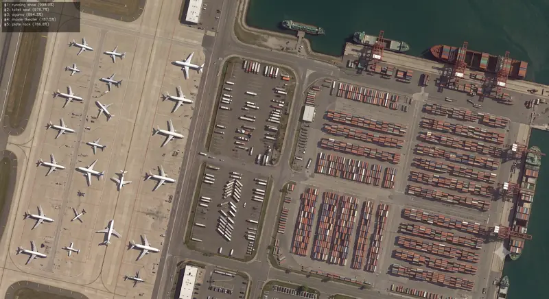

<!-- Generated by DX AI Studio (python -m dx_modelzoo.tools.export_dx_app_cards). Do not edit by hand. -->

# Ultralytics YOLO26-x-obb

OBB Detection · `yolo26-x-obb_1024x1024` · DX-APP Python example

Ultralytics YOLO26-x-obb — obb detection model, trained on DOTAv1.

**Input** 1024 × 1024 × 3 · **Dataset** DOTAv1 · **License** AGPL-3.0 · **Quantization** Q-Lite, Q-Pro



Full card with copy buttons and dark/light theme: [model.html](model.html)

## Quick start

Run from the dx_app root after `./install.sh` and `./build.sh`.

```bash
# from the dx_app root
./setup_sample_models.sh --models yolo26x-obb
```

**Python**

```bash
python src/python_example/oriented_object_detection/yolo26_obb/yolo26-x-obb_1024x1024/yolo26-x-obb_1024x1024_sync.py \
  --model assets/models/yolo26-x-obb_1024x1024.dxnn \
  --image sample/img/sample_airport_satellite_view.png
```

**C++**

```bash
./build.sh --target yolo26-x-obb_1024x1024_sync   # once
./bin/yolo26-x-obb_1024x1024_sync \
  -m assets/models/yolo26-x-obb_1024x1024.dxnn \
  -i sample/img/sample_airport_satellite_view.png
```

## Performance

**17 FPS** and **7.6 FPS/W** on DX-M1, DX Model Zoo reference measurement.

### Accuracy

| Quantization | mAP |
|---|---:|
| Raw · ONNX | 56.07 |
| Q-Lite | 55.10 (−0.97) |
| Q-Pro | 53.99 (−2.08) |

DOTAv1 · difference vs Raw in brackets.

### Measured on host boards

| Board | Throughput FPS | Single-stream FPS | Latency ms |
|---|---:|---:|---:|
| DX-H1 Quattro · BIOSTAR | 70.5 | 7.0 | 142.1 |
| DX-M1 · AIPlayer N97 | 17.2 | 6.5 | 154.4 |
| DX-M1 · Orange Pi 5+ | 17.1 | 5.8 | 173.8 |
| DX-M1 · ROCK 5B+ | 14.7 | 5.8 | 173.2 |
| DX-M1 · Raspberry Pi 5 | 17.0 | 6.5 | 153.6 |
| DX-M1M · Raspberry Pi 5 | 10.2 | 5.7 | 176.0 |

DX AI Studio Benchmark, July 2026, DX-RT without ORT. Throughput: 5 in-flight buffers. Single-stream: 1.

## Model

| | |
|---|---|
| Task | OBB Detection |
| Dataset | DOTAv1 |
| Metric | mAP |
| Input | 1024 × 1024 × 3 |
| Parameters | 57.62 M |
| Operations | 272.11 GOPs |
| Family | yolo26_obb |

## Downloads

| Artifact | Compiler | Files |
|---|---|---|
| ONNX | — | [ONNX](https://sdk.deepx.ai/modelzoo/onnx/yolo26-x-obb_1024x1024.onnx) |
| Q-Lite | DX-COM 2.5.0 | [DXNN](https://sdk.deepx.ai/modelzoo/q-lite-dxnn/2_5_0/yolo26-x-obb_1024x1024.dxnn) · [JSON](https://sdk.deepx.ai/modelzoo/q-lite-json/2_5_0/yolo26-x-obb_1024x1024.json) |
| Q-Pro | DX-COM 2.4.0 | [DXNN](https://sdk.deepx.ai/modelzoo/q-pro-dxnn/2_4_0/yolo26-x-obb_1024x1024.dxnn) |

## Files in this example

| File | What it is |
|---|---|
| `yolo26-x-obb_1024x1024_sync.py` | Python · one image, video or camera |
| `yolo26-x-obb_1024x1024_async.py` | Python · pipelined, higher throughput |
| `yolo26-x-obb_1024x1024_sync_cpp_postprocess.py` | Python with the C++ postprocess binding |
| `yolo26-x-obb_1024x1024_async_cpp_postprocess.py` | Python async with the C++ postprocess binding |
| `config.json` | Thresholds, input size, default sample |
| `factory/` | Pre-, post-processor and visualizer |

[C++ version of this example](../../../../cpp_example/oriented_object_detection/yolo26_obb/yolo26-x-obb_1024x1024/)

## Source & License

[ultralytics/ultralytics](https://github.com/ultralytics/ultralytics) — AGPL-3.0 (GNU Affero General Public License v3.0 — https://www.gnu.org/licenses/agpl-3.0.html) · © Ultralytics. Check the upstream license before commercial use.

Compile it yourself: DX-COM in dx-compiler, or DX AI Studio → Compiler.

---

<sub>Generated from the DX Model Zoo publish table (as of 2026-10-13). Board measurements: DX AI Studio Benchmark, July 2026. Open this model in DX AI Studio → Model Zoo for live inference and the model graph.</sub>
